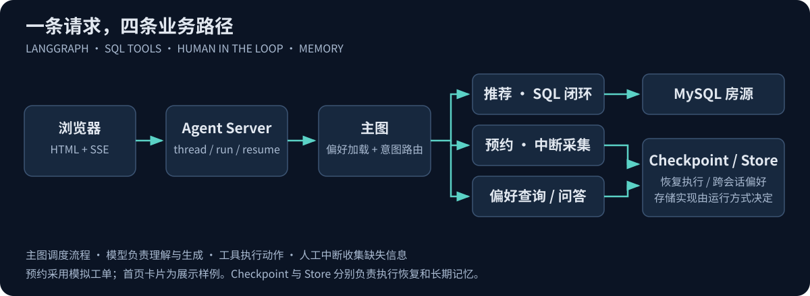

# 智能租房助手 · 从推荐子图读懂一套 Agent 工作流

> Python 3.11 · LangGraph · LangChain · ChatOpenRouter · MySQL · Store · SSE · Docker

用户说“帮我找几套房子”时，系统先补问城市与预算，再从数据源查询推荐；推荐后可继续预约，并在新会话中读到用户历史偏好。

项目将语言理解、流程控制和工具执行分开：模型提取需求与提出调用，图决定执行路径，工具完成查询或记录写入，Checkpoint 与 Store 负责两种不同生命周期的记忆。



**[交互复习台](https://qhkkkkk.github.io/agent-engineering-lab/) · [应用源码](app/) · [运行指南](docs/quickstart.md) · [测试](docs/testing.md)**

## 1. 五分钟理解项目

| 业务能力 | 实现机制 | 当前范围 |
| --- | --- | --- |
| 自然语言推荐 | 结构化抽取 + 自定义 SQL 工具闭环 | 查询条件与答案仍需真实数据/模型验证 |
| 缺失需求追问 | interrupt + 同 thread resume | 支持分次补充；不是新开一次无关对话 |
| 预约采集 | 顺序中断节点 + 工具调用 | 生成模拟工单，无库存、支付或签约 |
| 查询我的记录 | namespace 隔离的 Store 读取 | 演示 user_id，尚未接入登录授权 |
| 长期偏好 | 预算包络与预约摘要 | 与 Checkpoint 执行恢复分开 |
| 流式前端 | REST、SSE、显式等待状态 | 首页卡片为展示样例，刷新恢复尚未完善 |

### 一条业务链路

```text
“帮我找房” → 缺条件则追问 → 提取城市/预算/区域/数量
→ 列出表 → 读取结构 → 生成 SQL → 检查 → 执行 → 推荐回答
→ “需要预约吗？” → 采集标题/电话/身份字段 → 模拟工单写入
→ 新会话沿用同一用户标识 → 读取偏好与历史预约
```

### 三个技术重点

1. **把流程约束写进图。** 推荐与预约的循环和结束条件不同，分别拆成子图。
2. **把状态与协议理清。** messages 使用 reducer，查询检查替换待执行消息；人工中断依赖稳定重放。
3. **把长期数据放在正确边界。** State 管本次字段，Checkpoint 管 thread 恢复，Store 管跨 thread 偏好。

## 2. 源码阅读路线：先子图，最后主图

每章按“业务目的 → State → 节点函数 → 复杂语法 → 组装边 → 状态流转 → 自测”展开。首次阅读直接从最复杂的推荐子图开始，不必先背一遍框架概念。

| 顺序 | 章节 | 重点回答 |
| --- | --- | --- |
| **01** | [推荐子图](docs/chapters/01-recommendation.md) | 为什么有这些状态，如何抽取/补问/保存，SQL 工具怎样闭环，为什么替换消息 ID |
| **02** | [预约子图](docs/chapters/02-reservation.md) | 为什么顺序采集，add_sequence 做了什么，Annotated/ToolRuntime 怎么注入，Store 怎样追加 |
| **03** | [问答子图](docs/chapters/03-conversation.md) | 最小 MessagesState，消息列表拼接，链式建图，子图与主图终点的区别 |
| **04** | [主图](docs/chapters/04-main-graph.md) | 共享状态、内部通道、意图分类、条件路由与推荐转预约 |
| **05** | [Python 与框架语法](docs/chapters/05-python-and-framework.md) | Optional、Field、TypedDict、Literal、生成器、any/next、短路、仅关键字参数、序列化 |
| **06** | [前端与 API](docs/chapters/06-frontend-api.md) | thread/run、普通输入与 resume、SSE 分帧、去重与显示边界 |
| **07** | [部署原理](docs/chapters/07-deployment.md) | 工程配置、Server/CLI/Studio/SDK、三种 Docker 路径、依赖与迁移隔离 |
| **08** | [扩展设计](docs/chapters/08-evolution.md) | 消息管理、字段标准化、SQL 审批、custom stream、幂等与评测 |

## 3. 横向查阅

- [函数与状态索引](docs/implementation.md)：按文件找函数、按问题找章节。
- [架构与边界](docs/architecture.md)：模块职责与数据生命周期。
- [开发问题](docs/engineering-notes.md)：现象、原因、处理机制、验证方法。
- [项目讲解与技术追问](docs/interview.md)：项目介绍、机制与取舍。
- [运行指南](docs/quickstart.md)：需要开什么软件、执行什么、访问哪里。
- [API 请求示例](examples/README.md)：创建 thread、普通输入与恢复。

## 4. 代码坐标

```text
app/src/agent/
├── recommend.py / node/recommend.py / state/recommend.py
├── reserve.py   / node/reserve.py   / state/reserve.py
├── extend.py    / node/extend.py
├── graph.py     / node/main.py      / state/main.py
└── common/
    ├── llm.py          # ChatOpenRouter 与配置
    ├── context.py      # 运行上下文
    ├── store.py        # 偏好/预约摘要 schema
    └── preferences.py  # 合并与序列化
```

公开 [.env](app/.env) 已清空真实凭据，复制为 `.env.local` 后填写个人配置。私人配置不进入 Git 与镜像构建。数据补充见 [data](data/README.md)。

## 5. 验证与演进

11 项 Python 离线测试覆盖图组装、路由、中断恢复、分次需求、合法 0、预约摘要合并与 JSON 序列化；112 个 SSE 检查覆盖任意字节切分与中文解码。

这些测试不替代真实模型、MySQL、Docker 或并发/安全验证。当前下一步优先完成完整集成基线，再建设身份授权、SQL 执行约束、幂等订单、并发偏好更新和质量评测，详见[测试](docs/testing.md)与[扩展设计](docs/chapters/08-evolution.md)。
