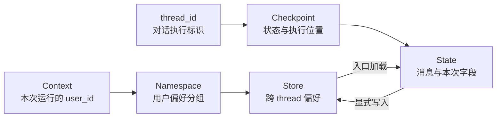
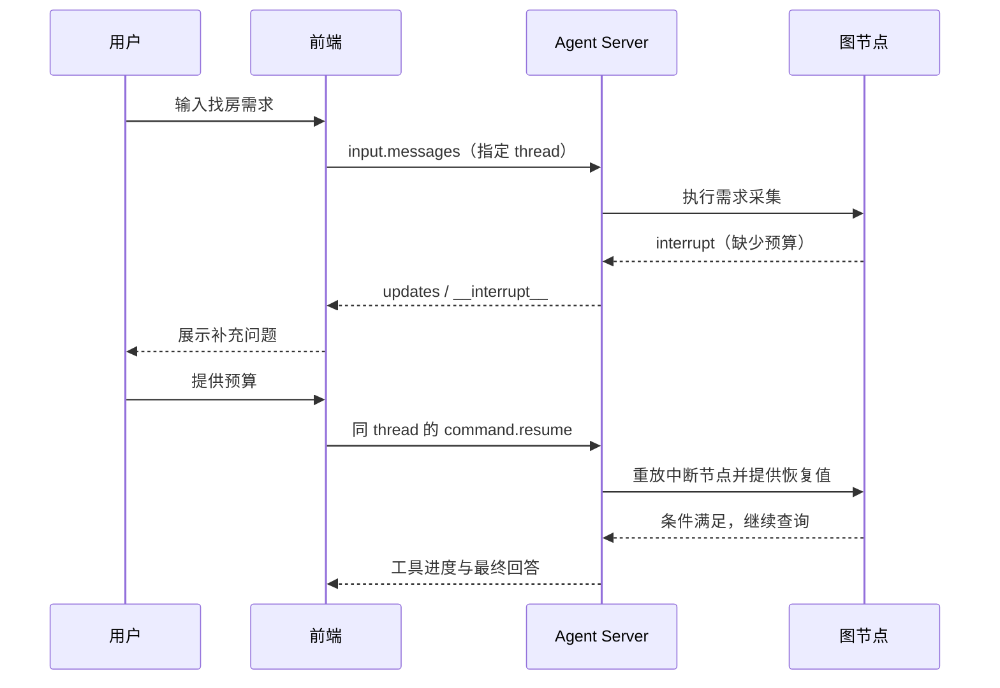

# 架构设计：让不确定的语言输入进入确定的业务路径

[项目文章](../README.md) · [代码实现](implementation.md)

## 1. 设计约束先于框架选型

用户可能分多次表达需求，也可能在推荐后转去预约。系统需要保留已经收集的信息，知道当前等待什么，并让外部工具的执行结果回到同一条业务链路。

由此得到四个约束：

1. **执行顺序可观察。** 能定位当前节点、输入、输出和下一步。
2. **等待用户时可恢复。** HTTP 请求可以结束，业务流程仍有恢复入口。
3. **外部动作有明确边界。** 模型决定调用，不直接等同于工具已经完成。
4. **不同生命周期的数据分开。** 一次查询条件、一个 thread 的执行状态、用户长期偏好不能混在一起。

LangGraph 的节点、条件边、Checkpoint 与 Store 正好能承载这些约束。选择它的原因是控制流程与状态管理，而不是为了把每个函数都包装成一个独立 Agent。

## 2. 系统分层

| 层 | 模块 | 输入/输出 | 主要职责 |
| --- | --- | --- | --- |
| 交互层 | `static/` | 用户输入、流式事件 | 展示、请求、等待状态与错误提示 |
| API 运行层 | Agent Server | thread、run、resume | 图加载、执行管理和服务端持久化 |
| 业务编排层 | `graph.py` 与三个子图 | State 局部更新 | 意图分流、顺序约束和循环终止 |
| 节点层 | `node/` | 状态、模型结果、工具结果 | 抽取、查询、采集与回答 |
| 数据/依赖层 | `state/`、`common/`、工具 | 类型、配置、Store、数据库 | 定义数据契约并执行外部操作 |

依赖方向是“图引用节点，节点使用状态与依赖”。前端不直接访问 MySQL，模型也不会直接拿到一个 Python Store 对象。

## 3. 主图为什么先读偏好，再识别意图

`get_store_info` 在入口把用户历史数据加载到 State，后续推荐与“我的记录”分支可以共用。好处是读取位置固定、后续节点不必各自补一套加载逻辑。

代价是一般问答也会发生一次偏好读取。当前优先选择简单一致的入口；如果请求量和读取成本明显增长，可以先分类，再只在需要的分支加载。

意图分类使用 Pydantic `Literal` 约束四类结果，再由普通 Python 路由函数映射节点。相比模型直接返回任意节点名，这样减少了无效路由结果，并能单独测试路由表。

## 4. 三张子图为什么采用不同形态

| 子图 | 不确定性在哪里 | 图提供什么约束 |
| --- | --- | --- |
| 推荐 | 用户需求抽取、选表、SQL 生成与答案组织 | 必要字段补齐、结构读取、检查与执行顺序 |
| 预约 | 用户分步输入、模型选择工具与总结结果 | 固定采集顺序、工具调用后回到模型 |
| 问答 | 一般自然语言问题 | 单独承接非业务意图，保留后续扩展位置 |

推荐采用“固定准备步骤 + 局部查询循环”，预约采用“顺序采集 + 工具循环”。强行把它们统一成一种模板，会让条件判断散落在提示词里，反而难以维护。

## 5. 状态与持久化边界

Checkpoint 不是长期用户资料表，Store 也不是恢复程序栈的机制。当前图自身调用 `compile()`，由 Agent Server 提供运行所需的持久化管理；独立运行或测试图时，则显式提供内存 checkpointer/Store。

框架机制参考：[Persistence](https://docs.langchain.com/oss/python/langgraph/persistence)。

### 本次预算与历史预算为什么能不同

State 中的预算描述“这一次找房的过滤要求”；Store 的预算采用历史区间包络。当前请求可以更窄，但不会因此自动收缩历史范围。

这种区分避免用户临时查询改变全部历史偏好。其代价是历史范围可能越来越宽，无法直接表达近期稳定意图。若产品需要“记住最新偏好”，应显式调整存储策略，而不是把它当成模型记忆效果的问题。

### 内部状态通道不等于安全隔离

`NeedReserveOutput.reserve` 供紧随其后的条件边使用，没有作为主 State 的顶层输出字段。但它仍可能出现在 updates 或追踪中。schema 过滤解决数据契约问题，认证与权限解决谁能访问的问题，两者不是同一个机制。

## 6. 两类协议边界

### 模型与工具之间：请求必须有结果

一个工具调用由名字、参数、调用 ID 组成；ToolMessage 用调用 ID 回答它。执行前改写 SQL 时，必须同步维护历史中的工具请求，避免留下未响应的旧调用。

`AIMessage.id` 控制消息替换，`tool_call.id` 控制调用配对。项目依靠消息 reducer 完成替换，而不是随意拼接两条 AIMessage。

### 浏览器与服务器之间：事件不等于网络块

HTTP 流中的一个 chunk 没有业务语义，只是一段字节。前端依次完成 UTF-8 解码、SSE 帧解析、JSON 解析和业务分发，避免把传输层边界误当消息边界。

这种分层还方便测试：不连接浏览器和模型，也能对同一事件做任意字节切分验证。

## 7. 人工等待的时序

HTTP 结束不代表工作流已到 END。前端保存“是否在等待补充”，服务端保存“具体停在哪里”。客户端不能仅靠上一条气泡恢复一个已经丢失的 thread。

## 8. 副作用和一致性

| 动作 | 当前安排 | 一致性风险 |
| --- | --- | --- |
| 需求抽取 | 在采集节点内调用模型 | 中断重放会重复抽取，结果可能变化 |
| 偏好预算写入 | 完成采集后写 Store | 先读后写可能与并发预约覆盖 |
| 模拟预约 | 工具生成 UUID 后追加摘要 | 重复调用可能生成多个工单 |
| 真实订单扩展 | 尚未接入 | 需要业务幂等键、事务与库存约束 |

图提供可恢复执行，不自动提供所有外部系统的“恰好一次”。工程上要逐个识别副作用，并决定重试、幂等和事务由哪一层保证。

## 9. 错误处理按责任分类

| 类别 | 例子 | 应如何处理 |
| --- | --- | --- |
| 用户可补充 | 缺城市、预算、采集字段 | interrupt，继续收集 |
| 模型可纠正 | SQL 字段错误、部分查询失败 | 将错误作为工具结果交回，限制重试次数 |
| 环境问题 | API Key 无效、数据库拒绝连接 | 明确报错，查配置与后端日志 |
| 程序问题 | 序列化失败、消息 ID 配错 | 修复数据契约并增加回归测试 |

人工中断属于业务等待，不应被宽泛的异常捕获吞掉；模型重试也不应被当成所有错误的默认答案。

## 10. 技术取舍总结

| 选择 | 获得什么 | 付出什么/后续方向 |
| --- | --- | --- |
| 图编排 | 顺序与分支明确、容易观察 | 需要维护状态 schema 和图拓扑 |
| 结构化抽取 | 字段可校验、可复用 | 语义正确性仍需评测 |
| 模型生成 SQL | 支持较灵活的自然语言条件 | 执行约束和权限必须额外建设 |
| Store 存偏好 | 跨会话复用、与消息解耦 | 并发一致性和身份授权需明确 |
| 原生 HTML/JS | 易于看清 API 与事件流程 | 会话管理、重连等能力需自行实现 |
| 外部 PG/Redis + API Compose | 复用独立服务，配置直观 | 依赖连通性、凭据与版本管理 |
