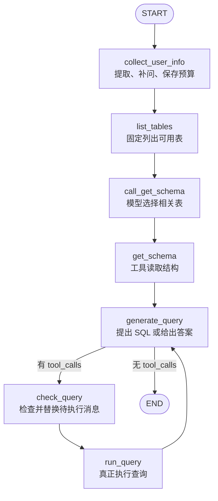

# 01 · 推荐子图：从 State 到 SQL 查询闭环

[阅读总目录](../../README.md) · 下一章：[预约子图](02-reservation.md)

本章直接从最复杂的子图开始。读完应能回答：每个状态字段给谁用，需求如何被补齐，模型怎样申请工具，工具如何执行，以及查询检查为什么必须维护消息 ID。

## 1. 先确定子图的输入、输出与职责

输入是一段用户需求和可选的历史偏好，输出是推荐回答消息，以及本次采集到的结构化条件。这个子图不负责识别“用户到底想预约还是找房”，也不负责推荐结束后的是否预约，这些留给主图。



这里有三种不同节点：普通 Python 准备动作、模型决策、工具执行。先把职责分开，才不会把 `bind_tools()` 误解成“数据库已经查完”。

## 2. 第一个文件：为什么这样设计 RecommendState

[查看实际代码：src/agent/state/recommend.py](../../app/src/agent/state/recommend.py#L4)

```python
class RecommendState(MessagesState):
    # 用户偏好数据（共享主图状态）
    # 为什么？因为如果当用户提问：给我在西安租套房。
    # 此时问题中不包含预算信息，则可以通过历史偏好数据，进行设置！！增加智能化
    user_preferences: dict

    # 以下是用户输入的推荐的关键参数
    city: str  # 城市
    budget_min: float  # 最低预算
    budget_max: float  # 最高预算
    district: str  # 区域
    room_type: str  # 房屋类型
    orientation: str  # 朝向
    room_count: int  # 推荐数量
    others: str  # 其它要求
```

| 字段 | 为什么存在 | 写入方 | 主要读取方 |
| --- | --- | --- | --- |
| `messages`（继承） | 模型需要看到需求、工具申请、工具结果和已有回答 | 采集、模型节点、ToolNode | 各模型节点、结束条件 |
| `user_preferences` | 用户本次可能没说预算，但历史偏好有参考值 | 主图加载；采集节点同步新偏好 | `collect_user_info`，返回主图后的共享状态 |
| `city` | 核心查询范围，也是追问是否完成的判断条件 | `collect_user_info` | 需求格式化与后续查询 |
| `budget_min/max` | 价格区间需要两个可计算的边界，不能只留“便宜点” | 同上 | 校验、偏好合并、查询提示 |
| `district` | 在城市内进一步缩小区域 | 同上 | 查询提示 |
| `room_type` | 表达整租、合租、户型等房屋诉求 | 同上 | 查询提示 |
| `orientation` | 朝向是独立条件，不与房型混写 | 同上 | 查询提示 |
| `room_count` | 控制希望推荐的数量及提示中的 top_k | 同上 | `generate_query` |
| `others` | 承接暂未建专用字段的要求 | 同上 | 查询提示 |

### 为什么保留字段，又要保留消息

字段便于校验、记忆、展示和规则处理；消息承载语言上下文与工具协议。两者解决的问题不同。当前 SQL 节点主要阅读格式化后的需求消息，而不是把每个 State 字段直接编译成确定性 SQL 条件，因此“State 有字段”不等于“查询一定落实了所有条件”。

### 为什么不把查询结果再存一份到 State

工具结果已经作为 ToolMessage 保存在 messages 中，生成节点可以读取；当前没有需要重复维护的独立房源结果字段。未来要用结构化卡片展示时，可以增加明确的 `list[HouseResult]`，并建立结果校验契约。

### 类型注解不会自动填满字典

`city: str` 是 schema 描述，不代表构造初始 State 时就有城市。缺失字段与消息 reducer 是两回事，节点读取尚未写入的可选信息应使用 `.get()`。TypedDict 也不是 Pydantic，不承担相同的运行时校验。

## 3. MessagesState 为什么改变了“返回列表”的含义

普通理解中 `messages = [x]` 像是覆盖，但节点实际返回的是局部更新：

```python
return {"messages": [response]}
```

图通过 `add_messages` 合并该更新：新消息 ID 追加，已有消息 ID 更新。以一条需求消息为例：

```text
执行前：[Human(id=h1)]
返回值：{"messages": [AI(id=a1)]}
合并后：[Human(id=h1), AI(id=a1)]

再次返回 AI(id=a1, content=修改后内容)
合并后：仍然两条消息，只替换第二条
```

这为后面的查询检查提供了“替换尚未执行的请求”的能力。不要把此规则推广到所有 list 状态；它来自 messages 对应的 reducer。

## 4. 第二个模型：UserInfo 为什么不直接复用 State

[查看实际代码：src/agent/node/recommend.py](../../app/src/agent/node/recommend.py#L23)

```python
class UserInfo(BaseModel):
    """用户的租房需求信息"""

    city: Optional[str] = Field(
        default=None,
        description="用户所在或想要租房的城市，例如：西安、北京、上海"
    )
    district: Optional[str] = Field(
        default=None,
        description="用户想要租房的具体区域或行政区，例如：雁塔区、碑林区、海淀区"
    )
    budget_min: Optional[float] = Field(
        default=None,
        description="用户的最低预算，单位为元/月。如果是xx元以内，要设置最小值为0"
    )
    budget_max: Optional[float] = Field(
        default=None,
        description="用户的最高预算，单位为元/月。如果是xx元以上，最大值设置为10000"
    )
    room_type: Optional[str] = Field(
        default=None,
        description="房屋类型，例如：整租、合租、公寓、一室一厅、两室一厅"
    )
    orientation: Optional[str] = Field(
        default=None,
        description="房屋朝向，例如：朝南、朝北、东南、南北通透"
    )
    room_count: Optional[int] = Field(
        default=None,
        description="需要推荐的房屋数量"
    )
    others: Optional[str] = Field(
        default=None,
        description="特殊要求，例如：带阳台、独立卫生间、近地铁、可养宠物、有电梯等"
    )
```

`RecommendState` 是整张图的工作数据，`UserInfo` 是一次模型抽取的输出契约。后者只应包含从语言中提取的字段，不应要求模型生成完整消息历史、Store 对象或内部执行信息。

### `Optional[float] = Field(default=None, description=...)` 拆开看

```python
budget_min: Optional[float] = Field(default=None, description="最低预算")
```

1. `budget_min`：字段名，后续用 `info.budget_min` 访问。
2. `Optional[float]`：允许 float 或 None，现代写法可写 `float | None`。
3. `default=None`：未提供时使用缺失值；单独写 Optional 不等于自动有默认值。
4. `description`：字段语义，结构化输出时也帮助模型理解应填什么。
5. `BaseModel`：让结果具备解析、字段校验和 `model_dump()` 等能力。

`None` 与 0 不能合并处理：“1500 元以内”可以抽取为 0–1500，0 是合法数字；缺失字段才是 None。字段描述是指导，不是单位换算与合法性验证的硬保证。

## 5. collect_user_info：拆成五段理解

签名中的信息已经说明了依赖来源：

```python
def collect_user_info(state: RecommendState,
                      runtime: Runtime[ContextSchema],
                      *, store: BaseStore):
```

| 写法 | 真实含义 |
| --- | --- |
| `state: RecommendState` | 节点读取当前工作状态；注解帮助框架和开发者理解结构 |
| `Runtime[ContextSchema]` | 带类型参数的运行上下文，不是函数调用或数组索引 |
| 单独的 `*` | 后面的 store 是仅限关键字参数；普通调用需写 `store=...` |
| `store: BaseStore` | 存储接口依赖，由运行环境注入；不是全局偏好字典 |

### 5.1 从消息中筛选用户输入

```python
user_messages = filter_messages(state["messages"], include_types="human")
pref = state.get("user_preferences")
```

messages 里还有 AIMessage、ToolMessage，抽取当前需求时先取 HumanMessage，避免把工具结果当成用户新要求。`user_messages[-1]` 表示最后一条，前提是输入确实包含用户消息；API 应对空输入建立校验。

有历史预算时，组合两条消息：第一条表达历史参考，第二条是本次用户诉求。提示词明确“最新消息优先”。这是一项应用合并策略，不是模型天然知道哪条一定优先。

### 5.2 嵌套函数：抽取和字典合并

[查看实际代码：src/agent/node/recommend.py](../../app/src/agent/node/recommend.py#L83)

```python
    def extract_info(messages) -> UserInfo:
        system_message = SystemMessage(
            content="""
你是一个租房需求信息提取专家。请从用户的描述与历史信息中提取租房相关信息。
如果用户历史偏好信息与最新用户消息冲突，以最新的用户消息为主。
只提取用户明确提到的信息，不要猜测或推断。
如果某个信息用户没有提到，就返回null。
注意预算的单位可能是元/月、元/天等，请统一转换为元/月。
如果用户提到价格范围，请分别提取最低和最高预算。
如果用户提到推荐几套房，提取room_count字段。"""
        )
        return model.with_structured_output(schema=UserInfo).invoke([system_message] + messages)
```

`extract_info` 定义在节点内部，是一个局部辅助函数。`model.with_structured_output(schema=UserInfo)` 返回带输出契约的调用对象，后面的 `.invoke(...)` 才真正发起模型请求。

`[system_message] + messages` 是两个列表拼接，构造“系统规则 + 待抽取输入”，不是把字符串加在一起，也不会修改原列表。

[查看实际代码：src/agent/node/recommend.py](../../app/src/agent/node/recommend.py#L97)

```python
    def update_state(current_state: dict, info: UserInfo) -> dict:
        if not info:
            return current_state

        user_info_dict = info.model_dump(exclude_none=True)
        current_state.update(user_info_dict)
        return current_state
```

这里 `model_dump(exclude_none=True)` 先把模型转成不含 None 的字典，再调用 `dict.update` 覆盖同名字段。例如已有 `{"city":"太原"}`，补充 `{"budget_min":500}` 后，城市保留。若不去掉 None，补充模型的空城市可能覆盖已经收集到的城市。

`dict.update(...)` 修改字典本身，返回值是 None，因此要先 update，再 `return current_state`，不能直接 return update 的结果。

### 5.3 缺项判断与人工中断

```python
if not updated_state.get("city"):
    missing_info.append("**城市**")
if updated_state.get("budget_min") is None or updated_state.get("budget_max") is None:
    missing_info.append("**预算范围**")
```

城市使用字符串空值判断；数字使用 None 判断。两种写法不是随意混用，而是依据字段语义。

有缺项则进入 `while missing_info`，`interrupt(prompt)` 把流程交回用户。恢复值不是自动进入新的 HumanMessage，而是先成为该调用的返回值；代码显式转成 HumanMessage，再次抽取并合并。只补城市时仍缺预算，应该继续追问。

用户明确选择“不提供”时，代码使用预算和数量默认值，并用“随机城市”占位。这是当前实现的限制：占位字符串不保证能命中实际数据。面向真实产品应使用明确默认城市、选择列表或询问是否放宽地域。

### 5.4 写偏好为什么要重新搜索 Store

State 中可能有偏好内容快照，但更新还需要持久化记录的 key。因此通过 namespace 搜索，再选择新增或更新：

```python
existing = prefs_result[0] if prefs_result else None
store.put(namespace, existing.key if existing else str(uuid.uuid4()), prefs)
```

这是 Python 条件表达式：“条件为真用左值，否则用右值”。空列表为 False，因此不会先访问 `[0]`。新增用新 UUID，更新用旧 key，才能覆盖同一记录。

预算合并的实际规则：

[查看实际代码：src/agent/common/preferences.py](../../app/src/agent/common/preferences.py#L15)

```python
def merge_budget_envelope(existing: dict | None, minimum: float | None,
                          maximum: float | None) -> dict:
    """保存历史区间包络；当前搜索预算仍以本次 State 为准。"""
    prefs = deepcopy(existing or {})
    if minimum is not None and (prefs.get("budget_min") is None or minimum < prefs["budget_min"]):
        prefs["budget_min"] = minimum
    if maximum is not None and (prefs.get("budget_max") is None or maximum > prefs["budget_max"]):
        prefs["budget_max"] = maximum
    return prefs
```

它保存历史包络：已有 500–5000，本次 1000–2000 不收窄；本次 0–6000 才向外扩。本次查询仍使用 State 中的本次预算，不应拿历史包络覆盖查询条件。

`deepcopy` 避免修改传入的嵌套对象；它不是数据库事务，也不解决并发覆盖。搜索后取第一条还假定一个用户只有一条偏好记录，未来需要唯一键与原子更新约束。

### 5.5 最后为什么再构造一条 HumanMessage

[查看实际代码：src/agent/state/recommend.py](../../app/src/agent/state/recommend.py#L22)

```python
def get_recommend_info(state: dict) -> str:
    info_prompt = """
提取用户期望推荐的房源信息如下：
- 城市: {city}
- 区域: {district}
- 预算: {budget_min} - {budget_max} 元/月
- 房屋类型: {room_type}
- 朝向: {orientation}
- 特殊要求: {others}
- 推荐数量: {room_count}
如果某些信息未指定，请使用合适的默认值或放宽条件。"""
    return info_prompt.format(
        city=state.get('city', '未指定'),
        district=state.get('district', '未指定'),
        budget_min=state.get('budget_min', '未指定'),
        budget_max=state.get('budget_max', '未指定'),
        room_type=state.get('room_type', '未指定'),
        orientation=state.get('orientation', '未指定'),
        others=state.get('others', '无'),
        room_count=state.get('room_count', 5)
    )
```

这是从原始字段到模型可读表达的转换。`.format(city=..., ...)` 为模板占位符传值；`.get('city','未指定')` 在键不存在时提供默认值。若键存在但值是 None，第二个参数不会自动生效，这与 `value or default` 的语义不同。

```python
updated_state["messages"] = [HumanMessage(content=get_recommend_info(updated_state))]
return updated_state
```

此处先更新节点局部字典，返回后才通过图的 reducer 进入全局 State；messages 的这条列表会合并到历史中。

## 6. 数据库工具初始化：生成器表达式先拆开

```python
toolkit = SQLDatabaseToolkit(db=db, llm=model)
tools = toolkit.get_tools()
get_schema_tool = next(tool for tool in tools if tool.name == "sql_db_schema")
get_schema_node = ToolNode([get_schema_tool], name="get_schema")
```

第三行可以理解为：遍历工具列表，找到名字匹配的第一个工具，将它赋给变量。`(tool for ... if ...)` 是惰性的生成器表达式，`next(...)` 取下一项；不是列表推导式。没有匹配项会抛 StopIteration，可在依赖启动检查时给出更明确错误。

`[get_schema_tool]` 是包含一个工具的列表，因为 ToolNode 接收工具集合。`get_schema_tool` 是可执行工具；`get_schema_node` 是封装执行流程的图节点。ToolNode 的 name 与图注册名可以相关，但不等于所有名字天然互相绑定。

工具包还提供 query checker 工具，但本项目真正连到图里的 `check_query` 是自定义模型节点。不要由工具列表推导执行路径。

## 7. list_tables：为什么第一步不用模型决定

[查看实际代码：src/agent/node/recommend.py](../../app/src/agent/node/recommend.py#L204)

```python
def list_tables(state: RecommendState):
    # 1. 获取AIMessage(tool_calls)
    tool_call = {
        "name": "sql_db_list_tables",
        "args": {},
        "id": str(uuid.uuid4()),
        "type": "tool_call",
    }
    # 模拟必定调用工具
    tool_call_message = AIMessage(content="", tool_calls=[tool_call])

    # 2. 手动调用工具：sql_db_list_tables
    list_tables_tool = next(tool for tool in tools if tool.name == "sql_db_list_tables")
    tool_message = list_tables_tool.invoke(tool_call)

    # 3. 整合结果
    response = AIMessage(content=f"可用的表：{tool_message.content}")
    return {
        "messages": [tool_call_message, tool_message, response]
    }
```

列出表是固定的准备动作，可以直接完成，不额外花一次模型调用来决定是否列出。

代码构造 `tool_call` 字典，再包装成 AIMessage，调用工具后获得匹配的 ToolMessage。返回的三条消息分别表示“申请动作、动作结果、可读摘要”。手动构造调用时保留 id，才能保持消息协议完整。

`list_tables_tool.invoke(tool_call)` 在这里是直接执行工具；它与下一节模型的 invoke 不是同一职责。相同方法名不意味着相同对象和行为。

## 8. call_get_schema / get_schema：决策和执行为什么分两节点

[查看实际代码：src/agent/node/recommend.py](../../app/src/agent/node/recommend.py#L226)

```python
def call_get_schema(state: RecommendState):
    llm_with_tools =  model.bind_tools([get_schema_tool], tool_choice="any")
    # llm 根据历史消息筛选表，并获取需要的表信息
    response =  llm_with_tools.invoke(state["messages"])  # AIMessage(tool_calls)
    # 下一步一定是会调用get_schema_tool工具的！
    return {
        "messages": [response]
    }
```

| 调用 | 获得什么 |
| --- | --- |
| `model.bind_tools(...)` | 一个知道工具定义的模型调用对象 |
| `tool_choice='any'` | 约束本次模型必须提出某个已绑定工具的调用，前提是供应商支持 |
| `llm_with_tools.invoke(...)` | AIMessage，通常含 tool_calls |
| 进入 `get_schema` 的 ToolNode | 真正读取结构，生成 ToolMessage |

为什么不在一个函数里做完？分开后图中能观察“模型想读哪些表”和“实际读回什么”，也方便分别处理错误或插入审批。代价是多了节点与消息管理。

## 9. generate_query：一个节点为什么既生成 SQL 又回答

[查看实际代码：src/agent/node/recommend.py](../../app/src/agent/node/recommend.py#L239)

```python
def generate_query(state: RecommendState):
    generate_query_system_prompt = """
您是一个设计用于与SQL数据库交互的代理。
给定一个输入问题，创建一个语法正确的{dialect}查询来运行，然后查看查询的结果并返回答案。
需要根据rows from table的示例设置真实查询的值。
除非用户指定了他们希望获得的特定数量的示例，否则始终将查询限制为最多{top_k}个结果。
您可以按相关列对结果排序，以返回最感兴趣的结果。不要查询特定表中的所有列，只查询给定问题的相关列。
不要对数据库做任何DML语句（INSERT， UPDATE， DELETE， DROP等)。
        """
    system_prompt = generate_query_system_prompt.format(
        dialect=db.dialect,
        top_k=state.get("room_count", 5)
    )

    system_message = SystemMessage(content=system_prompt)
    llm_with_tools = model.bind_tools([run_query_tool])
    return {
        "messages": [llm_with_tools.invoke([system_message] + state["messages"])]  # AIMessage(tool_call?)
    }
```

它绑定查询工具，但不强制调用。第一次看到需求与结构时，可以提出 SQL；拿到工具结果后，可以直接回答。两次进入同一个函数，消息历史不同，因此承担不同阶段的任务。

`{dialect}` 来自数据库方言，`top_k` 来自本次数量或默认值。它们替换到系统提示中。数量限制和禁止写操作目前仍是提示约束，不是确定性的执行沙箱。

如果强制该节点每次都调用工具，它就难以在查询完成后自然输出最终答案；如果完全不提供执行约束，又可能过早结束。因此本项目把局部生成留给模型，把是否检查、执行的路由留给图。

## 10. check_query：消息 ID 是本子图最关键的协议细节

[查看实际代码：src/agent/node/recommend.py](../../app/src/agent/node/recommend.py#L266)

```python
def check_query(state: RecommendState):
    # 走到这个节点，上一个节点必然是generate_query，并且最新的消息必然是AIMessage(tool_call)
    check_query_system_prompt = """
你是一个非常注重细节的SQL专家。仔细检查{dialect}查询中的常见错误，包括：
-使用NULL值的NOT IN
-在应该使用UNION ALL时使用UNION
-使用BETWEEN表示独占范围
-谓词中的数据类型不匹配
-正确引用标识符
-使用正确数量的函数参数
-转换为正确的数据类型
-使用合适的列进行连接
如果存在上述任何错误，请重写查询。如果没有错误，只需复制原始查询即可。
在运行此检查之后，您将调用适当的工具来执行查询。
        """.format(dialect=db.dialect)
    system_message = SystemMessage(content=check_query_system_prompt)
    # 将SQL当作用户消息传入进行检查
    tool_call = state["messages"][-1].tool_calls[0]
    # tool_call["args"]["query"] 就能拿到SQL
    # tool_call: {
    #     "name": sql_db_query  # 运行sql
    #     "args": {"query": "select ....."}              # sql
    #     "id":
    # }
    user_message = HumanMessage(content=tool_call["args"]["query"])
    llm_with_tools = model.bind_tools([run_query_tool], tool_choice="any")  # 必须让AIMessage带上tool_calls
    response = llm_with_tools.invoke([system_message, user_message])  # 带tool_calls的AIMessage
    # 目前最新的一个消息是AI(t)，现在又生成了一个AI(t)，则可以将两个合成一个
    response.id = state["messages"][-1].id
    return {"messages": [response]}
```

逐步展开：

1. `state['messages'][-1]`：拿到上一步准备执行的 AIMessage。
2. `.tool_calls[0]`：取第一条调用，不代表支持多条并行调用。
3. `['args']['query']`：从嵌套字典中取 SQL 文本。
4. 构造 HumanMessage：本次模型的直接任务是检查这段查询。
5. 强制工具调用：检查后仍要产出可执行请求。
6. `response.id = old.id`：替换 messages 中的旧请求，不把两个待执行请求都留下。

```text
消息 ID：AIMessage.id = a1
工具调用 ID：AIMessage.tool_calls[0].id = call_1
工具结果的配对键：ToolMessage.tool_call_id = call_1
```

检查节点用新消息内容覆盖 a1，工具调用本身可以有新的 ID；ToolNode 回答的是最终保留下来的调用。把消息 ID 与调用 ID 混用，会让历史看似完整却不符合模型接口协议。

为什么不能仅追加检查结果？如果旧 AI 工具请求没有结果就留在历史里，模型供应商可能拒绝下一次请求。替换是在工具执行前维护一致性，不是篡改已完成查询的结果。

## 11. 最后才组装推荐图

[完整组装代码](../../app/src/agent/recommend.py)。

```python
builder = StateGraph(RecommendState, context_schema=ContextSchema)
builder.add_node("get_schema", get_schema_node)
builder.add_node("run_query", run_query_node)
builder.add_edge("check_query", "run_query")
builder.add_edge("run_query", "generate_query")
```

函数节点可以直接由函数名推导图内名称；ToolNode 实例在注册时显式给出名称，更容易看清边的目标。

[查看实际代码：src/agent/recommend.py](../../app/src/agent/recommend.py#L23)

```python
def should_continue(state: RecommendState):
    last_msg = state["messages"][-1]
    if not last_msg.tool_calls:
        return END
    return "check_query"
```

路由只判断当前最后一条 AIMessage 是否还有工具调用：有则进入检查，没有则到 END。`not []` 为 True，表示空调用列表。

`add_conditional_edges(source, router, [END,'check_query'])` 的第三个参数限定/声明可能目标，并不会替代 router 执行判断。静态边与条件边最终组成查询循环。

## 12. 把状态流转走一遍

以下是控制流示例，内容与 ID 仅为说明，不伪造实际房源结果。

| 阶段 | 关键状态/消息变化 | 下一步依据 |
| --- | --- | --- |
| 初始 | Human“帮我找房”，偏好为空 | 需求字段不足 |
| 采集 | city=太原，budget=500–1500，room_count=3 | 条件满足 |
| 需求消息 | 追加格式化 HumanMessage | 固定列出表 |
| 表结构 | AI 申请结构工具 → Tool 返回结构 | 生成查询 |
| 查询提案 | AI(id=a1, tool_calls=[调用]) | 有工具调用 |
| 检查 | 以相同消息 id 替换提案 | 执行最终调用 |
| 执行 | ToolMessage 回答最终调用 ID | 再次生成 |
| 回答 | AIMessage 无 tool_calls | 推荐子图 END |

推荐子图结束不等于整张主图 END：嵌入主图后，主图还可以接着询问是否预约。下一章先看预约子图自身。

## 13. 复习自检

<details><summary>为什么不把 UserInfo 直接作为整个图 State？</summary>

UserInfo 是一次抽取输出；图还需要消息、历史偏好和执行过程数据。将它们混为一体会让模型承担不该填写的字段。
</details>

<details><summary>dict.update、model_dump、add_messages 各自在哪里生效？</summary>

model_dump 把模型转成字典；dict.update 合并节点局部字段；节点返回后，add_messages 才负责图 messages channel 的更新。
</details>

<details><summary>为什么 check_query 强制工具调用，而 generate_query 不强制？</summary>

检查节点输出要可执行；生成节点在已有结果时需要允许自然语言终止。强制策略依据阶段职责不同。
</details>

<details><summary>本子图还有哪些工程边界？</summary>

单调用检查、提示词限制、没有专门重试预算、并发 Store 更新、占位城市、中断内重复模型抽取，都需要进一步设计。不能由一次成功查询推导为任意场景都可靠。
</details>
