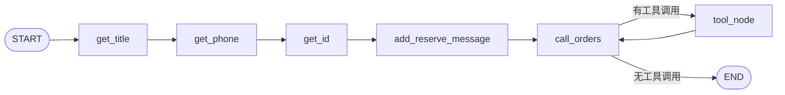

# 02 · 预约子图：顺序采集、运行依赖与工单工具

上一章：[推荐子图](01-recommendation.md) · [总目录](../../README.md) · 下一章：[问答子图](03-conversation.md)

推荐是在不确定查询中循环，预约则有明确的信息收集顺序。本章先看 State 为什么只放这几个字段，再理解 interrupt、`add_sequence`、工具注入和 Store 写入。

## 1. 先把实际业务范围定下来

当前预约流程收集房源标题、电话和身份字段，生成 UUID 工单号，将预约摘要保存到用户偏好。它还没有锁定真实房源库存、支付或签约流程。



顺序采集没有必要交给模型随意决定；信息完整后，再进入模型与工具之间的调用循环。

## 2. ReserveState：每个字段用在哪一步

[查看实际代码：src/agent/state/reserve.py](../../app/src/agent/state/reserve.py#L4)

```python
class ReserveState(MessagesState):
    title: str           # 预定的房源
    phone_number: str    # 预定电话
    id_card: str         # 身份证
```

| 字段 | 写入节点 | 保留到状态中的原因 | 下一读取点 |
| --- | --- | --- | --- |
| `messages` | 输入、格式化消息、模型、工具 | 保持模型与工具的对话协议 | `call_orders`、ToolNode |
| `title` | `get_title` | 下一轮中断时仍保留已采集标题 | `add_reserve_message` |
| `phone_number` | `get_phone` | 采集身份证时无需重新问电话 | 同上及工单参数 |
| `id_card` | `get_id` | 将身份输入传到后续预约请求 | 同上及工单参数 |

如果只是函数内部变量，在节点结束后后续节点无法直接读取，也无法依赖图检查点查看采集进度。跨节点要使用的数据才进入 State。

字段没有单独保存预约工单号，是因为当前工具结果以 ToolMessage 返回，最终回答可从消息读到；长期查询则使用 Store 中的预约摘要。以后需要确定性的业务订单状态，应增加明确结果字段或订单服务。

## 3. get_title：最小的人工输入节点

[查看实际代码：src/agent/node/reserve.py](../../app/src/agent/node/reserve.py#L15)

```python
def get_title(state: ReserveState):
    prompt = "请输入要预定的房源名称"

    while True:
        title = interrupt(prompt)
        if title:  # 验证操作
            return {"title": title}

        # 验证失败：再次输入
        prompt = f"‘{title}’ 不是一个有效的房源名称，请更正"
```

按执行顺序理解：

1. `prompt` 保存这次需要问的问题。
2. `while True` 表示持续询问，直到节点 return。
3. `interrupt(prompt)` 第一次使图暂停；恢复后提供用户的输入值。
4. `if title` 只检查真假，目前不验证数据库中真的存在房源。
5. `return {'title': title}` 更新 State 的 title，然后图才能进入下一节点。
6. 无效时更新 prompt，下一次 interrupt 使用纠正提示。

`return` 不只退出 if，而是退出当前函数与 while。无效输入不应该直接进入 get_phone。

### 同样模式为什么可以用于电话与身份证

[查看实际代码：src/agent/node/reserve.py](../../app/src/agent/node/reserve.py#L28)

```python
def get_phone(state: ReserveState):
    prompt = "请输入要预定的手机号"

    while True:
        phone_number = interrupt(prompt)
        if phone_number:  # 验证操作
            return {"phone_number": phone_number}

        # 验证失败：再次输入
        prompt = f"‘{phone_number}’ 不是一个有效的电话号码，请更正"
```

[查看实际代码：src/agent/node/reserve.py](../../app/src/agent/node/reserve.py#L41)

```python
def get_id(state: ReserveState):
    prompt = "请输入要预定的身份证号码"

    while True:
        id_card = interrupt(prompt)
        if id_card:  # 验证操作
            return {"id_card": id_card}

        # 验证失败：再次输入
        prompt = f"‘{id_card}’ 不是一个有效的身份证号码，请更正"
```

三者控制模式相同，写入键和提示不同。当前校验只验证非空，因此 `demo-phone` 这样的虚构值可用于控制流测试；这不代表号码格式已经通过业务验证。

分三个节点的好处是检查点能明确显示“标题已收集、现在等电话”，副作用与调试定位更容易。代价是多次交互。若改成一次收集多个字段，则需对部分填写和重复补充建立更复杂的合并规则。

## 4. 这段 while 在恢复时究竟怎样执行

```text
第一次：进入 get_title → interrupt 暂停
恢复“虚构房源甲”：重跑 get_title → 对应 interrupt 返回该值 → title 写入 State
然后：进入 get_phone → 新 interrupt 暂停
恢复“demo-phone”：继续原 thread → get_phone 完成 → 进入 get_id
```

框架保存的是可恢复的执行状态，而非把 Python 栈冻住。中断节点前部会重跑，同一节点内多次 interrupt 依赖稳定的调用顺序。新增、删除或改换中断顺序时，需要考虑已有挂起任务的兼容性。

如果把“发送确认短信”放在中断前，恢复可能重复发送。因此采集节点只收信息，真正的外部动作集中到工具执行，并进一步考虑幂等。

## 5. add_reserve_message：为什么字段收齐后还要组装消息

[查看实际代码：src/agent/node/reserve.py](../../app/src/agent/node/reserve.py#L53)

```python
def add_reserve_message(state: ReserveState):
    reserve_prompt = """
根据提供的信息，帮我预定房源。
- 预定的房源标题：{title}
- 用户预定号码：{phone_number}
- 用户身份证号码：{id_card}
    """

    return {"messages": [HumanMessage(content=reserve_prompt.format(
        title=state["title"],
        phone_number=state["phone_number"],
        id_card=state["id_card"]
    ))]}
```

采集字段是程序可访问的数据，但 `call_orders` 主要阅读 messages。这一步建立字段到模型输入的适配层，让模型看到一次完整的预约请求，而不是零散的恢复输入。

### `reserve_prompt.format(...)` 拆解

模板中的 `{title}` 等占位符由同名关键字参数填充；`state['title']` 表示这里要求前序节点已经保证字段存在。如果没有依次经过采集节点就直接执行，应预期 KeyError，而不是自动出现默认标题。

返回 HumanMessage 是追加到已有 messages，不清空历史；这是 `MessagesState` reducer 的效果。

身份字段虽然不会写入最终的 `ReservedInfo`，却被这一步放进消息与 State。因此不能因为摘要中没有身份证，就认为系统中从未处理或持久化过它。演示只使用虚构资料。

## 6. 预约摘要和用户偏好：为什么有两个 Pydantic 模型

[查看实际代码：src/agent/common/store.py](../../app/src/agent/common/store.py#L5)

```python
class ReservedInfo(BaseModel):
    """预定信息"""
    order_id: str = Field(description="预定id")
    title: str = Field(description="预定的房源标题")
    phone_number: str = Field(description="预定电话")

    price: Optional[float] = Field(
        default=None,
        description="预定的房源价格，单位为元/月"
    )
    intro: Optional[str] = Field(
        default=None,
        description="预定的房源介绍"
    )
    city_name: Optional[str] = Field(
        default=None,
        description="预定的房源所在城市名"
    )
    region_name: Optional[str] = Field(
        default=None,
        description="预定的房源所在区/县"
    )
```

[查看实际代码：src/agent/common/store.py](../../app/src/agent/common/store.py#L28)

```python
class UserPreferences(BaseModel):
    """用户偏好数据"""

    budget_min: Optional[float] = Field(
        default=None,
        description="用户的最低预算，单位为元/月"
    )
    budget_max: Optional[float] = Field(
        default=None,
        description="用户的最高预算，单位为元/月"
    )
    reserved_info: Optional[list[ReservedInfo]] = Field(
        default=None,
        description="预定过的房源列表"
    )
```

`ReservedInfo` 描述一条预约，`UserPreferences` 描述一个用户的偏好集合。`Optional[list[ReservedInfo]]` 要从里向外读：一条记录模型 → 多条记录列表 → 整个列表可以缺失。

工单号、标题和电话是创建记录需要的核心字段；价格、区域等可选字段为后续扩展预留，目前工具不会自动填齐它们。类型定义里有字段，不代表当前功能已经采集或查询了该字段。

### Field 为什么有的没有 default

`order_id: str = Field(description=...)` 没有默认值，创建模型时需要提供。`price: Optional[float] = Field(default=None, ...)` 则可缺省。两种写法反映数据契约，不是排版风格。

## 7. generate_orders：普通参数和注入参数分开读

[查看实际代码：src/agent/node/reserve.py](../../app/src/agent/node/reserve.py#L72)

```python
@tool
def generate_orders(phone_number: str, id_card: str, house_title: str,
                    runtime: ToolRuntime, store: Annotated[Any, InjectedStore()]) -> str:
    """
根据用户电话、身份证、预定的房源，生成工单号。

Args:
    phone_number: 用户电话
    id_card：身份证
    house_title：用户要预定的房源标题
    runtime：工具的运行时信息
    store：注入工具的持久存储
    """

    # 1. 模拟生成工单号(扩展：持久化订单表)
    order_id = str(uuid.uuid4())

    # 2. 构建预定信息
    reserved_info = ReservedInfo(
        order_id=order_id,
        title=house_title,
        phone_number=phone_number
    )

    # 3. 持久化存储用户偏好（预定信息）
    namespace = preference_namespace(runtime.context)
    # 查询
    prefs_result = store.search(namespace)
    existing = prefs_result[0] if prefs_result else None
    prefs = append_reservation(existing.value if existing else {}, reserved_info)
    store.put(namespace, existing.key if existing else str(uuid.uuid4()), prefs)

    return f"已成功预定房源：{house_title}, 预定工单号为：{order_id}"
```

### `@tool` 做了什么

装饰器把函数包装成可供模型了解并请求的工具，利用函数名、参数类型和 docstring 形成工具描述。它不是“定义完就运行”。只有后续模型申请、ToolNode 执行时，函数体才产生副作用。

### 参数的来源

| 参数 | 谁提供 | 为什么不一样 |
| --- | --- | --- |
| `phone_number/id_card/house_title` | AIMessage 的 tool call args | 业务数据，模型从预约请求中组织 |
| `runtime: ToolRuntime` | 工具执行运行时 | 当前状态、上下文等依赖不该由模型猜 |
| `store: Annotated[Any, InjectedStore()]` | ToolNode 的依赖注入 | Store 不是可放进 JSON 参数里的普通对象 |

`Annotated[T, metadata]` 给类型附加元数据。这里的 `Any` 表示宽泛类型，`InjectedStore()` 是框架能识别的注入标记；方括号不是调用，真正构造标记的是后面的圆括号。

ToolRuntime 和 store 注入都依赖运行环境正确配置。单独把这个函数按普通 Python 方式调用，不会神奇地凭空获得真实数据库。

### 工具体分四步

1. `str(uuid.uuid4())`：构造 UUID 对象，再转成可序列化字符串，用作模拟工单号。
2. 创建 `ReservedInfo`：把业务数据约束成记录模型。
3. 由 `runtime.context` 得到 user_id，构造 namespace 并搜索旧偏好。
4. 创建或合并摘要，使用新 key 或旧 key 写 Store，返回工具结果字符串。

`id_card` 目前参与工具参数但没有进入预约摘要，也没有真实身份验证。这个事实应与日志、追踪、检查点的敏感数据处理一起考虑。

## 8. 持久化写入：.value、.key、model_dump 为什么都需要

```python
existing = prefs_result[0] if prefs_result else None
prefs = append_reservation(existing.value if existing else {}, reserved_info)
store.put(namespace, existing.key if existing else str(uuid.uuid4()), prefs)
```

搜索结果是记录列表：`[0]` 取第一条，`.value` 取内容，`.key` 取记录标识。列表非空判断用于安全索引，不能替代真正取值。

[查看实际代码：src/agent/common/preferences.py](../../app/src/agent/common/preferences.py#L26)

```python
def append_reservation(existing: dict | None, reservation: ReservedInfo) -> dict:
    """新建和更新分支都写入 JSON 值，兼容旧记录中的 reserved_info=null。"""
    prefs = deepcopy(existing or {})
    records = list(prefs.get("reserved_info") or [])
    records.append(reservation.model_dump(mode="json", exclude_none=True))
    prefs["reserved_info"] = records
    return prefs
```

这里处理三个不同问题：

- `deepcopy(existing or {})`：没有旧值用空字典，并隔离对旧嵌套对象的修改。
- `list(prefs.get('reserved_info') or [])`：缺键或 null 都得到可追加列表。
- `model_dump(mode='json', exclude_none=True)`：写入普通 JSON 值，避免只在内存中可用的模型对象混入列表。

### 为什么不能只用 setdefault

```python
prefs.setdefault('reserved_info', [])
```

它只在键不存在时设置默认值。键存在但值为 None 时会返回 None，不会修成列表。默认值处理与序列化处理是两件事。

新增使用新 UUID，更新使用 existing.key。否则每次预约都可能新建另一条用户偏好记录，而查询又只读第一条，造成“写了但看不到”。

当前仍是先读后写，没有原子追加和幂等约束。两个请求同时更新可能覆盖；工具重试可能创建两个 UUID。这些不能由 deepcopy 或图检查点自动解决。

## 9. call_orders：模型为什么还要再跑一次

[查看实际代码：src/agent/node/reserve.py](../../app/src/agent/node/reserve.py#L110)

```python
def call_orders(state: ReserveState):
    return {"messages": [model.bind_tools([generate_orders]).invoke(
        [SystemMessage(content="你是一个工单生成的助手，支持调用工具进行房源预定工单生成。支持查看结果并返回最终答案")]
        + state["messages"]
    )]}
```

第一次调用时，模型根据完整预约消息提出 generate_orders 的调用。工具执行后，ToolMessage 加入历史，再次调用模型，模型才能把结果转成用户可读的最终回答。

如果执行完工具直接结束，返回的是原始工具结果，缺少一次统一的结果组织；如果不断强制调用工具，又可能重复预约。因此这里绑定工具但不强制每次调用，由条件边识别是否结束。

## 10. 最后组装：add_sequence 与 tools_condition

[完整图定义](../../app/src/agent/reserve.py)。

```python
builder.add_sequence([get_title, get_phone, get_id,
                      add_reserve_message, call_orders])
builder.add_edge(START, "get_title")
builder.add_conditional_edges("call_orders", tools_condition,
    {"tools": "tool_node", "__end__": END})
builder.add_edge("tool_node", "call_orders")
```

`add_sequence` 注册这些节点，并连接相邻步骤；并没有代替入口、结束和工具循环。

条件映射从左向右读：`tools_condition` 返回 `"tools"`，图进入实际名为 `"tool_node"` 的节点；返回 `"__end__"` 则结束。返回标签与节点名不同没有问题，映射要一致。

为什么 `tool_node → call_orders` 回边必需？这给模型读取工具结果并停止的机会。整个循环停在“模型不再提出工具调用”，不是以工具返回字符串作为判断。

## 11. 数据从哪里流到哪里

```text
resume 标题 → State.title
resume 电话 → State.phone_number
resume 身份字段 → State.id_card
    ↓ format
HumanMessage（完整预约请求）
    ↓ bind_tools + invoke
AIMessage（工具调用 JSON）
    ↓ ToolNode 注入 runtime/store
生成模拟工单 → 预约摘要写 Store
    ↓ ToolMessage
AIMessage（最终回答）
```

## 12. 复习自检

<details><summary>add_sequence 是否包含 START 和 END？</summary>

它连相邻节点，入口、条件路由和终点仍需按流程定义；不能把顺序注册误认为完整业务图。
</details>

<details><summary>模型为什么不能直接生成 Store 作为参数？</summary>

Store 是运行依赖对象，不是 JSON 业务值。注入由框架负责，模型只组织允许暴露的工具参数。
</details>

<details><summary>工单号与偏好记录 key 是同一个 ID 吗？</summary>

不是。工单号标识一次预约，Store key 标识用户偏好记录；一条偏好记录可包含多个工单摘要。
</details>
