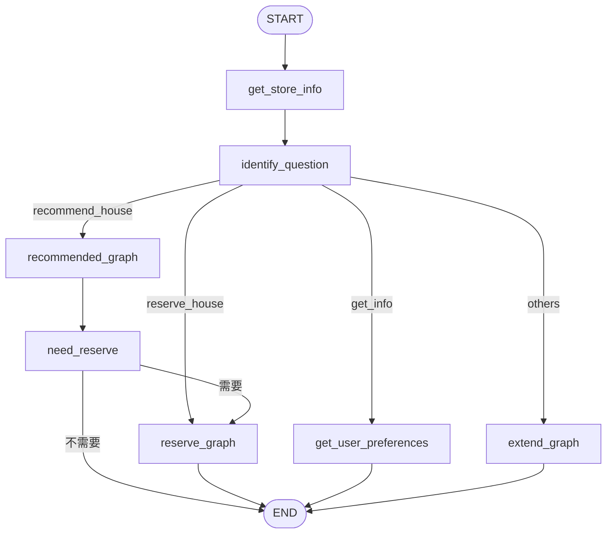

# 04 · 最后组装主图：意图、长期记忆与子图衔接

上一章：[问答子图](03-conversation.md) · [总目录](../../README.md) · 下一章：[语法索引](05-python-and-framework.md)

三个子图已经分别能完成局部工作。主图解决它们之前没有处理的事情：谁来接这次输入、先加载什么信息，以及推荐后如何自然转到预约。

## 1. 先读主 State 与内部通道

[查看实际代码：src/agent/state/main.py](../../app/src/agent/state/main.py#L6)

```python
class State(MessagesState):
    user_preferences: dict   # 用户偏好数据
    user_intent: str         # 用戶意图
```

| 字段 | 为什么放主图 | 写入点 | 读取点 |
| --- | --- | --- | --- |
| messages | 各子图需要共享用户上下文和回答 | 输入与各节点更新 | 分类、推荐、预约、问答 |
| user_preferences | 读取的历史偏好可交给推荐或记录查询 | get_store_info 与推荐同步 | 推荐、get_user_preferences |
| user_intent | 模型分类结果要交给普通代码路由 | identify_question | router_message |

[查看实际代码：src/agent/state/main.py](../../app/src/agent/state/main.py#L11)

```python
class NeedReserveOutput(TypedDict):
    reserve: str  # 需要、不需要
```

`reserve` 只承担推荐之后的下一跳决策，因此作为节点输出所引入的内部 channel，不放进主 State 的常规输出字段。

### “私有”由谁保证

不是 TypedDict 类名带来了私有，也不是 `str` 做了枚举限制。框架根据图与节点 schema 组织 channel，主输出 schema 过滤对外顶层字段。updates 和追踪仍可能看到内部更新，因此这不是隐私访问控制。

本项目有离线测试检查：`reserve` 在 `graph.channels` 中，在 `graph.output_channels` 中没有。业务值还由 need_reserve 显式校验。

## 2. ContextSchema 为什么不放到 State

[查看实际代码：src/agent/common/context.py](../../app/src/agent/common/context.py#L4)

```python
class ContextSchema(TypedDict):
    user_id: str
```

user_id 用来选择用户的长期偏好分组，是本次执行依赖。它不应由模型从消息中猜测，也不应被任意节点作为普通业务状态随意覆盖。

```text
Context.user_id → (user_id, "preferences") → Store 记录
thread_id      → 当前对话和待恢复执行
```

演示客户端仍可手动传 user_id，所以还不具备真正的登录授权。生产场景要由服务端身份系统绑定它，并校验 thread 的访问权。

## 3. get_store_info：读取记录不只是读一个 dict

[查看实际代码：src/agent/node/main.py](../../app/src/agent/node/main.py#L15)

```python
def get_store_info(state: State, runtime: Runtime[ContextSchema], * , store: BaseStore):
    # 搜索用户信息
    namespace = preference_namespace(runtime.context)
    prefs_result = store.search(namespace)
    if prefs_result:
        return {
            "user_preferences": prefs_result[0].value or {}
        }
    else:
        return {
            "user_preferences": {}
        }
```

namespace 的实际校验：

[查看实际代码：src/agent/common/preferences.py](../../app/src/agent/common/preferences.py#L8)

```python
def preference_namespace(context: Mapping[str, Any] | None) -> tuple[str, str]:
    user_id = (context or {}).get("user_id")
    if not isinstance(user_id, str) or not user_id.strip():
        raise ValueError("context.user_id 必须是非空字符串")
    return (user_id.strip(), "preferences")
```

`store.search(namespace)` 返回记录列表，空列表是假。只有列表非空才取 `[0].value`。`.value or {}` 又兼容了空的记录值，这是不同层次的两次默认处理。

常见写法 `if result and result[0]` 利用 and 短路：左边为 False 时不算右边。但如果接口已经保证列表元素为有效记录，第二次真假检查往往没有必要；它也不是读取内容的替代品。

为什么每次入口都返回 `user_preferences={}`？没有记录时明确清空本次偏好快照，避免同一 thread 中错误沿用之前状态。当前先加载再分类，即使普通问答也会读取一次；这换取入口一致性，后续可按读成本优化。

## 4. identify_question：模型做分类，代码做路由

[查看实际代码：src/agent/node/main.py](../../app/src/agent/node/main.py#L28)

```python
class UserMessage(BaseModel):
    type: Literal["recommend_house", "reserve_house", "get_info", "others"] = Field(
        description="根据用户问题描述判断问题类型：推荐房源、预定房源、获取信息、其它内容"
    )
```

[查看实际代码：src/agent/node/main.py](../../app/src/agent/node/main.py#L34)

```python
def identify_question(state: State):
    # state["messages"] # 用户问题  -》 LLM  -> 结构化输出（type） : 推荐、预定、我的、其它
    user_intent = model.with_structured_output(UserMessage).invoke(
        [SystemMessage(content="你是一个根据描述提取信息的提取专家。请从用户的描述中提取想要咨询的相关信息。"
                    "严谨根据语义推断信息，但是不能猜测或者编造信息。"), state["messages"][-1]]
    )
    return {
        "user_intent": user_intent.type  # 条件边使用
    }
```

`Literal` 将输出限制到四个类别。`with_structured_output(UserMessage)` 返回可按 `.type` 访问的对象；模型不直接输出任意 Python 节点名。

这里主要读取最新消息，并非完整的多轮意图理解器。如果用户只说“就这个吧”，需要更多上下文消歧；可扩展为选择相关对话或利用当前流程状态，而不是假定四分类能解决全部语境。

### 路由函数为什么是普通 Python

[查看实际代码：src/agent/graph.py](../../app/src/agent/graph.py#L27)

```python
def router_message(state: State) -> Literal["recommended_graph", "reserve_graph", "extend_graph", "get_user_preferences"]:
    user_intent = state["user_intent"]
    if user_intent == "recommend_house":
        return "recommended_graph"
    elif user_intent == "reserve_house":
        return "reserve_graph"
    elif user_intent == "get_info":
        return "get_user_preferences"
    else:
        return "extend_graph"
```

从固定标签到固定节点是确定性映射，不需要再调用模型。返回值注解 `Literal[...]` 告诉类型工具/框架可能的目标，但运行时真正返回什么仍由分支代码决定。

注意两组名字：模型分类标签 `recommend_house` 对应图内节点 `recommended_graph`；不要因为字符串不同就认为必须改成一样。

## 5. get_user_preferences：如何把已有记录交给模型回答

[查看实际代码：src/agent/node/main.py](../../app/src/agent/node/main.py#L56)

```python
def get_user_preferences(state: State):

    # 获取最新历史偏好信息（参考答案）
    prefs = state.get("user_preferences", {})
    # 筛选用户消息（获取到用户问题）
    user_messages = filter_messages(state["messages"], include_types="human")
    reserved_info = prefs.get("reserved_info", [])
    if reserved_info:
        # 有预定过的信息
        reserved_str = "\n"
        for i, item in enumerate(reserved_info, 1):
            reserved_str += f"{i}. 预定工单ID: {item.get('order_id')}，" \
                            f"房源标题：{item.get('title')}，" \
                            f"预定电话：{item.get('phone_number')}\n"
    else:
        # 没有预定
        reserved_str = "无"

    result = model.invoke(
        [SystemMessage(content="""你是一个乐于助人的助手，可以根据用户偏好信息进行回复。
如果有的偏好数据为空，不要猜测或编造数据。
不要直接回复偏好数据是什么，要结合问题进行生动回复。
如果问题与用户偏好数据无关，直接回复即可。""") ,
         HumanMessage(content="用户的历史偏好信息如下"
                      f"1. 最低预算：{prefs.get('budget_min')}"
                      f"2. 最高预算：{prefs.get('budget_max')}"
                      f"3. 已预定过的信息：{reserved_str}"
                      ) ,
         user_messages[-1]  # 问题
        ]
    )
    return {
        "messages": [result]
    }
```

读取顺序是“当前问题、偏好快照、预约列表”。`enumerate(reserved_info,1)` 同时拿到序号和记录，起始值为 1，便于面向用户展示；字典的 `.get()` 避免缺失可选字段时报错。

相邻字符串字面量在括号中可以隐式拼接；f-string 在花括号里求表达式。这种写法用于形成参考内容，不是向用户直接展示原始 JSON。

最后模型同时看到系统约束、偏好参考和当前问题。系统提示要求不要编造空数据，但这仍是提示约束；如果需要严格事实回答，可先用结构化结果/模板限定可输出信息。

## 6. need_reserve：跨子图的人工决策

[查看实际代码：src/agent/node/main.py](../../app/src/agent/node/main.py#L45)

```python
def need_reserve(state: State) -> NeedReserveOutput:
    prompt = f"已经为您推荐合适的房源，是否需要帮您预订房源？\n"
    prompt += "如果不需要,请输入'**不需要**'。\n"
    prompt += "如果需要,请输入'**需要**'。\n(注意输入其它值无效)\n"
    while True:
        answer = str(interrupt(prompt)).strip()
        if answer in {"需要", "不需要"}:
            return {"reserve": answer}
        prompt = "请输入：需要 或 不需要。"  # 条件边获取到后，是否执行预定子图
```

为什么这一步放主图？因为推荐子图只负责找房，它可以独立使用；是否继续预约是业务编排，不该让推荐子图强耦合预约流程。

`str(...).strip()` 把恢复值转成文本并去首尾空格，再严格接收“需要/不需要”。其他输入继续问，避免一句“也许吧”被默认为确定业务选择。

[查看实际代码：src/agent/graph.py](../../app/src/agent/graph.py#L46)

```python
def should_reserve(state: NeedReserveOutput):
    reserve = state["reserve"]
    if reserve == "需要":
        return "reserve_graph"
    else:
        return END
```

这条条件边读取内部通道，决定进入 reserve_graph 或主 END。中断的等待与恢复仍属于同一 thread，不新建一套预约服务上下文。

## 7. 逐段组装主图

```python
builder = StateGraph(State, context_schema=ContextSchema)
builder.add_node("recommended_graph", recommended_graph)
builder.add_node("reserve_graph", reserve_graph)
builder.add_node("extend_graph", extend_graph)
```

把 compiled graph 直接注册成节点，父图按共享字段与子图交换状态。messages 和 user_preferences 是主要共享键；子图中的 city、phone_number 等专用字段，不会仅因嵌入就自动变成主图所有公开字段。

```python
builder.add_edge(START, "get_store_info")
builder.add_edge("get_store_info", "identify_question")
builder.add_conditional_edges("identify_question", router_message,
    ["recommended_graph", "reserve_graph", "extend_graph", "get_user_preferences"])
```

先固定读取与分类，再决定业务分支。第三个参数列出可能的路径；router_message 是决定本次去哪的函数，不能把函数的返回标签和映射配置混淆。

```python
builder.add_edge("recommended_graph", "need_reserve")
builder.add_conditional_edges("need_reserve", should_reserve, ["reserve_graph", END])
builder.add_edge("reserve_graph", END)
builder.add_edge("get_user_preferences", END)
builder.add_edge("extend_graph", END)
graph = builder.compile()
```

每条业务分支都具备明确出口。推荐子图完成后进入人工询问；其他分支完成后主图结束。`compile()` 校验并构建可执行图，不会自己启动服务。

## 8. 主图全貌



## 9. 为什么 compile 没传 checkpointer / store

这份图是交给 Agent Server 运行的，服务端管理检查点、长期存储和执行 API。因此代码定义与服务器的运行配置分开。

离开 Server 独立 invoke 图时，需要自己提供持久化依赖；本项目的离线测试使用 `InMemorySaver()` 和 `InMemoryStore()`。不能把“某处没写 checkpointer”理解成中断无需检查点，也不能给各子图随意再建一套不一致的持久化。

子图内中断在嵌入场景由父执行体系管理。客户端恢复整个 thread，框架定位待恢复的子图任务；不是由浏览器自行选择调用 get_phone。

## 10. 一次主图执行后的边界

主图 END 表示本次 run 完成，不代表 thread 被删除，也不代表 Store 被清空。用户下一条普通消息仍可以在同一 thread 发起新 run；新 thread 使用同 user_id 则可以读长期偏好，但不能自动接回旧中断。

<details><summary>先加载偏好再分类的取舍是什么？</summary>

入口简单一致，各分支有同一快照；代价是无关问答也有存储读取。可以在成本明显时改成按分支加载。
</details>

<details><summary>为什么不能让分类结果直接当任意节点名？</summary>

固定结构化标签和路由映射将模型输出与可执行目标隔开，避免不合法名称，也便于分别测试模型分类和确定性路由。
</details>

<details><summary>多个图是不是多个进程或容器？</summary>

不是。它们是编译图对象，可注册到同一个 Agent Server；是否拆服务是部署决策，不由子图数量决定。
</details>
