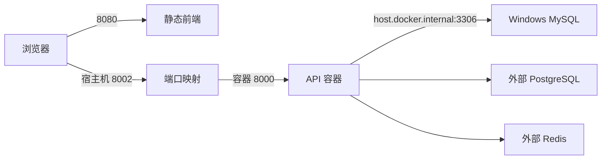

# 07 · 从代码到部署：工程配置、服务组件与三种 Docker 路径

[前端与 API](06-frontend-api.md) · [总目录](../../README.md) · 下一章：[演进设计](08-evolution.md)

动手命令集中在[运行指南](../quickstart.md)。这一章解释这些命令背后的组件，以及为什么改变运行方式时不能只换一个 URL。

## 1. 先读工程文件的职责

| 文件 | 决定什么 | 不负责什么 |
| --- | --- | --- |
| pyproject.toml | Python 版本、依赖、包名、构建和 src 布局 | 业务图的路由 |
| langgraph.json | 可加载图、依赖目录、环境文件、镜像选项 | 直接运行网页 |
| Dockerfile | 基础环境、复制与安装代码、服务图注册 | 自动保证外部数据库可达 |
| compose.yaml | API 容器、端口、环境文件等编排 | 本项目中不自动创建已有 PG/Redis |
| .env / .env.local | 公开默认配置 / 私人凭据 | 应用的函数实现 |

### langgraph.json 的路径怎么读

```json
{
  "dependencies": ["."],
  "graphs": {
    "house_agent": "./src/agent/graph.py:graph",
    "recommended_agent": "./src/agent/recommend.py:recommended_graph",
    "reserve_agent": "./src/agent/reserve.py:reserve_graph",
    "extend_agent": "./src/agent/extend.py:extend_graph"
  },
  "env": ".env.local",
  "image_distro": "wolfi"
}
```

`dependencies:['.']` 指安装当前项目；`文件路径:变量` 定位已编译图；graphs 的键是服务端入口 ID。不是把 Python 文件名直接当作前端 assistant_id。

包采用 src 布局，安装后通过 `agent.*` 导入；`src` 是源码根目录，不应该靠当前工作目录碰巧可导入来掩盖包配置问题。

## 2. LangGraph 与 Agent Server 不是同一个层

| 组件 | 可以怎样理解 |
| --- | --- |
| LangGraph | 图、状态、节点与执行模型的库 |
| Agent Server | 把图包装成可调用服务，管理 thread、run、状态与持久化 |
| CLI | 开发、构建镜像、生成部署文件与启动服务的命令工具 |
| Studio | 查看图、运行节点、检查中断与状态的交互界面 |
| SDK | 客户端以 Python/其他语言调用服务 API 的封装 |
| RemoteGraph | 将远端图包装为类似本地图调用的代理 |
| Control Plane | 部署创建、配置和生命周期管理层 |
| Data Plane | 实际处理图执行与其依赖的运行层 |

当前独立 Docker 运行不需要为了“完整”额外搭一套 Control Plane。浏览器 Studio 连接本机服务，也不意味着模型或长期记忆就自动搬到了 Studio 网站。

## 3. 三种持久化概念别混在一起

| 系统 | 本项目职责 |
| --- | --- |
| MySQL | 房源业务查询数据源 |
| PostgreSQL | 独立 Agent Server 的持久化后端，含运行相关数据与 Store 支持 |
| Redis | 相应服务栈的任务协调/事件流组件；不是本项目房源表 |

具体职责与部署拓扑应以选择的 Server 版本为准。代码 `BaseStore` 是接口，数据究竟放本机开发目录还是外部数据库，需要看运行方式，不能根据界面上出现 Memory 就判断云端存储。

追踪是另一个开关。启用 tracing 时可能将运行信息送到 LangSmith；模型请求本身也会发送给模型供应商。把“偏好存储本地”与“所有数据从不出网”画等号是不成立的。

## 4. 开发运行与独立服务器的区别

`langgraph dev` 适合调试与热更新，提供本地开发运行时，常见运行数据位于 `.langgraph_api` 等本机目录。它并非仅凭“memory”一词就能断言关闭窗口立刻丢掉全部状态。

独立 Docker API 使用自己配置的 PostgreSQL/Redis。切换到它不会自动把开发历史迁移过去。thread 与用户 namespace 相同，也不能跨两个完全独立后端凭空共享数据。

## 5. 路径一：先 build，再 docker run

```powershell
langgraph build -t house-agent-image
docker run --name house-agent-manual --env-file .env.local -e DB_HOST=host.docker.internal -p 127.0.0.1:8001:8000 house-agent-image
```

`-t` 给镜像命名，镜像是应用和依赖的构建产物；run 创建容器进程。镜像构建成功不代表已经运行服务。`docker image ls` 查看镜像，`docker ps` 只看运行容器，`docker ps -a` 还包含停止的容器。

之后启动已有容器用 start，不是重复 run 同名容器。修改运行时凭据需要重建容器的环境，而不一定要重新构建镜像。

## 6. 路径二：Dockerfile + Compose

```powershell
langgraph dockerfile -c langgraph.json Dockerfile
docker compose up -d --build
```

生成命令将图配置转成镜像构建描述；langgraph.json 变更后要重新生成。Compose 管理一组运行参数，减少长命令手写错误。

当前 YAML 只管理 API，复用已有 PG/Redis。如果采用完整栈，则应在 Compose 中增加 Redis、PostgreSQL、持久卷、健康检查和依赖关系：

```text
Redis healthcheck 成功 ─────┐
                          ├→ API 启动
PostgreSQL healthcheck 成功 ┘
```

健康检查解决“容器进程创建了但数据库还没就绪”的一部分问题；`depends_on: service_healthy` 不会替应用保证以后永不掉线。PG 持久卷用于让容器替换后保留数据库文件。

### env_file 与环境插值不是一件事

Compose 的 `env_file` 把变量注入容器；YAML 中的 `${VAR}` 是 Compose 解析文件时做的变量替换，来源与 `--env-file` 等设置有关。不能因为写了容器 env_file，就假定所有 `${VAR}` 都自动从同一文件得到值。

### 为什么未挂载的 volume 声明没有实际作用

只在顶层声明一个 volume 名称，不把它挂到对应服务路径，不会自动持久化应用状态。当前仅 API 方案依赖外部数据库，不需要为了形式照写一个未使用卷。

## 7. 路径三：langgraph up

```powershell
langgraph up --port 8003
```

CLI 管理它生成的 Docker 栈与辅助服务，具体复用数据库的行为取决于版本和参数。显式指定端口，避免默认值变化造成“服务起来了但访问错端口”。

它不是绕过 Docker 的纯 Python 模式，也不会自动给应用分配一个可以直接公网访问的新 IP。

## 8. 端口与地址：从访问者的位置理解



左侧宿主端口给浏览器用，右侧是容器内服务端口。对容器来说 localhost 是自己，不是 Windows 主机。对另一个同网络容器，应使用服务名与容器端口，而不是默认沿用宿主映射。

`ECONNREFUSED` 优先查进程、退出日志和端口映射；HTTP 422 优先查请求体；SQL 节点报错再查工具数据。按层排查比反复改 URL 更有效。

## 9. 为什么数据库迁移必须考虑隔离

开发运行时、手写检查点表和不同版本 Agent Server 可能拥有不同 schema 假设。直接让它们共用同一数据库，可能因字段类型或迁移状态冲突而失败。

先备份，使用独立数据库/环境验证迁移，再决定切换；不要为了让服务启动而删除已有数据。这里是服务端存储兼容性问题，不是房源推荐逻辑的问题。

## 10. 从启动成功到业务验收

应依次检查：服务可达 → 注册图可加载 → 模型可用 → MySQL 可查询 → 人工中断能恢复 → 预约能写入 → 新 thread 能读偏好。

Studio、健康检查和 Docker 的 Up 标签分别只能证明某个局部状态。实际能力要用完整业务场景验收，版本固定后再形成可重复部署基线。
